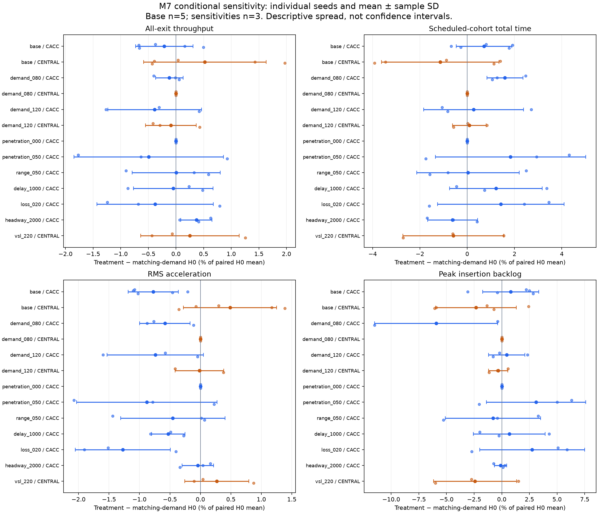

# US-101 autonomous traffic coordination: final research report

Research package dated 2026-10-18. Study corridor: US-101 northbound from SR-237
to the Oregon Expressway/Page Mill Road connection. M0-M8 are complete at this
project's practical experiment standard. The model's held-out traffic fidelity
remains limited. This report synthesizes frozen M3-M7 experiments; M8 introduces
no new simulation or controller tuning.

## Plain-language conclusion

These experiments do not establish that either tested coordination policy
consistently improves traffic. The supervised cooperative policy makes exported
longitudinal acceleration slightly smoother in the base comparison, while its
mean travel-time and throughput effects are unfavorable. The centralized speed
limit policy has small favorable base mean effects, but they vary across seeds
and do not persist at higher demand. At lower demand it never activates and
exactly matches the human baseline.

This is useful evidence about two specific simulated policies and their
measurement tradeoffs. It does not establish that autonomous driving generally
helps or harms traffic. The human baseline misses severe congestion on one
held-out day, cooperative commands engage for only about 2% of passenger
samples, and the policy experiments use one calibration date. Improving those
limits is necessary before stronger real-world inference.

## Question and scope

How do a fixed supervised cooperative-following policy and one centralized
variable speed limit (VSL) intervention change throughput, trip time, on-road
stopping, speed variability and acceleration smoothness relative to human-like
traffic under identical modeled inputs?

The original [charter](experiment-charter.md) proposed several possible AV
scenarios. The completed comparison is H0, supervised CACC and independent
CENTRAL VSL. An autonomous-without-cooperation treatment, continuous full-fleet
CACC, learned control and a full Bay Area model were not established. The
accepted [roadmap](project-roadmap.md) and milestone specifications define the
implemented scope; charter aspirations are not additional measured outcomes.

## Corridor, observations and baseline

The OSM-derived network and versioned corrections passed a practical M2 audit
of directed through routes and 40 adjacent branch junctions. That review checks
plausible geometry, lane counts, ramp sides, legal links and connectivity; it
is not an as-built certification or verification of loop wiring. Four measured
side movements carry H0 demand. Other unresolved movements include calibrated
aggregate net-entry groups of 700 and 2000 veh/h and a net-exit group of
1500 veh/h. Their assigned edges do not make them measured individual ramps.
See the [M2 acceptance](us101-m2-acceptance.md) and
[demand ledger](m3-demand-ledger.md).

Caltrans District 4 PeMS Station 5-Minute and Station Metadata exports supply
local observations. Missing observations remain missing. The reviewed M1
inventory has 13 accepted northbound mainline cross-sections inside the study
endpoint, five exclusions and one conservative holdout. Only eight accepted
stations have adequate coverage on most selected dates. The M3 inlet proxy is
station 400790 with a separately labeled 80% coverage threshold; six scored
full-cross-section stations require 90%. Station 402377's four-of-five modeled
lane subset is evaluated separately, and the 401948 lane mismatch is excluded
from aggregate scoring. Observed speeds are targets, not vehicle commands.
See the [sensor audit](us101-sensor-audit.md).

H0 uses Krauss following, tau 1.5 s, sigma 0.5, passenger speedFactor 1.0 and
speedDev 0.1, native lane changing, and a generic 4% truck proxy. The truck share
comes from an annual local count, not study-day directional classification.
The existing 1007.33 m upstream buffer, missing-movement hypotheses and vehicle
settings were selected from a bounded 12-candidate calibration search.

Calibration dates are October 7-10 and 14, 2025, with seeds 41-43. October 8 was
selected as the representative day by median upstream flow before fitting.
October 15 and 16 were held out, with the same seeds and frozen treatment hash.
Their measured inlet/ramp flows remain inputs, so this is conditional traffic
propagation validation, not demand forecasting. No held-out result was used to
retune the model. Mean errors give equal weight to six scoring stations, then
seeds and dates. The targets are flow MAPE <=20% and speed MAE <=10 mph.

| Evaluation | Runs | Flow MAPE | Speed MAE | Interpretation |
| --- | ---: | ---: | ---: | --- |
| Five calibration days | 15 | 8.32% | 8.15 mph | Mean targets met |
| Held out 2025-10-15 | 3 | 29.95% | 21.50 mph | Both missed |
| Held out 2025-10-16 | 3 | 8.79% | 8.30 mph | Both met |
| Held out, equal day weights | 6 | 19.37% | 14.90 mph | Speed target missed |

All 21 final calibration/validation runs cleared cleanly; operational run health
does not establish traffic fidelity. October 15's upstream congestion is poorly
reproduced, and no verified evidence identifies its cause. A high-demand M3
sensitivity also failed clearance, with 1357 vehicles waiting and 100 running.
It remains visible. The [M3 report](m3-human-baseline-report.md),
[freeze](../reports/m3/freeze.json), and
[generated score table](../reports/m8/results.md) retain this distinction.

## Policy definitions

**H0** retains native human-like following and maneuvers. **CACC** equips
passengers with a deterministic external longitudinal overlay, retaining native
Krauss safety constraints and all truck behavior. After insertion or any native
maneuver request, it waits for 2 s of quiet native lane-change state. Strategic,
cooperative, blocking and other nonquiet flags hand speed authority to SUMO.
Equipment does not imply continuous control.

For speed v, allowed speed V, TraCI gap r (excluding ego minGap), leader speed u
and previous-step acceleration b, the base overlay computes cruise acceleration
0.4*(V-v) and following acceleration 0.2*(r-1.5*v)+0.8*(u-v)+0.5*b. It takes
the smaller acceleration, clips to [-4.5,2.6] m/s^2, integrates a 0.5 s speed
request and bounds it by [0,V]. Trucks do not broadcast, so their followers omit
feedforward. No leader within the explicit 250 m gap cutoff uses cruise alone.
Native speedMode 31 and laneChangeMode 1621 remain. See the
[active CACC spec](m5-supervised-cacc-spec.md) for exact supervisor semantics.

The accepted full M5 comparison has active-command fractions 2.06%, 2.06% and
1.99% across seeds 41-43, measured over all-run passenger timesteps. Persistent
overlay, best-lane-only release and native SUMO CACC variants were rejected:
they produced wrong-lane/merge teleports or emergency-braking warnings. They are
not pooled with the accepted policy and are not silently replaced by successful
seeds. [M5 closeout](m5-cooperative-cacc-report.md) preserves every variant.

**CENTRAL** acts on human-like traffic independently of CACC. Every 30 s it
uses vehicle-timestep-weighted mean speed on nine downstream observation lanes.
Below 15 m/s it targets 25 m/s on 14 lane segments of the inlet buffer; above
20 m/s it releases. Equality/in-band retains mode; empty observations release.
Changes are limited to 1 m/s per update, recovery begins after the observation
window, and original limits are restored before closing. Native following and
maneuvers remain. This is ideal simulated sensing/actuation, not measured field
compliance. Exact edges and timing are in the [VSL spec](m6-centralized-control-spec.md).

## Measurement and fair comparisons

SUMO/libsumo 1.27.1 runs at 0.5 s steps. Fifteen minutes of warmup repeat the
first input demand interval. Measurement is [900,8100) seconds (07:00-09:00),
with one-second trajectory samples, followed by 7200 s clearance. Default
export precision limits trajectory reconstruction. Matching treatments share
network, demand, routes, fleet, speed factors, intended schedules and seed.
Seed equality does not guarantee identical realized maneuvers or actual-departure
cohorts. Controller and physical input hashes remain frozen.

| Measure | Operational definition and limit |
| --- | --- |
| All-exit throughput (veh/h) | All route completions in the two-hour window divided by two, including ramps and warmup departures; not mainline bottleneck capacity |
| Actual-departure travel time (s) | Trips actually inserted in the window, followed through clearance; excludes insertion delay |
| Scheduled-cohort total time (s) | Trip duration plus departDelay for intended window departures, reconstructed as actual departure minus departDelay; suppressed when schedules are incomplete |
| On-road queue proxies (vehicles) | Counts with exported speed <0.1 m/s; not contiguous queue length; approach proxies exclude shared mainline/internal edges |
| Insertion backlog (vehicles) | SUMO vehicles waiting to enter; report alongside on-road stopping to detect relocated delay |
| Temporal speed variability (mph) | Population SD of nonempty timestep domain mean speeds, with ramps/buffer/internal links; not proof of wave stability |
| RMS acceleration (m/s^2) | Square root of mean squared exported longitudinal acceleration over window vehicle samples; not energy or fuel use |

The complete [M4 contract](m4-experiment-harness-spec.md) and
[M7 metric distributions](../reports/m7/report.json) cover 30 metrics. These
metrics have different populations; a favorable single proxy is insufficient
for an overall benefit claim.

## Main results and sensitivity

M6's three-seed comparison is replayed exactly within M7's expanded base.
The five-seed M7 base is the principal synthesis here; the overlapping M5/M6
runs are not independent replicated campaigns to pool for a larger sample.

| Base policy minus H0 | n | Throughput | Scheduled total time | RMS acceleration | Peak insertion backlog |
| --- | ---: | ---: | ---: | ---: | ---: |
| CACC | 5 | -0.212% | +0.709% | -0.775% | +0.810% |
| CENTRAL | 5 | +0.523% | -1.146% | +0.487% | -2.331% |

The H0 base means are 8266.00 veh/h throughput and 1540.50 s scheduled total
time. CENTRAL's paired changes are +43.20 +/- 91.50 veh/h and
-17.65 +/- 38.24 s (mean +/- sample SD). Both favorable directions occur on
only 3/5 seeds; spread exceeds the mean effects. CACC's corresponding changes
are -17.50 +/- 42.97 veh/h and +10.93 +/- 18.01 s. Its RMS acceleration falls
on all five seeds. These are descriptive results, without significance tests,
confidence intervals or a common benefit score.

The other question-level indicators also have mixed interpretations:

| Base policy minus H0 | Mean on-road stopped vehicles | Temporal SD of mean speed |
| --- | ---: | ---: |
| CACC | -1.888% | -2.066% |
| CENTRAL | +0.554% | -2.953% |

These values use the same five paired seeds. Lower domain speed variability
can reflect traffic composition as well as dynamics. CENTRAL's on-road stopped
proxy rises while insertion backlog falls; report both. The complete 30-metric
paired distributions and spreads remain in the accepted M7 machine report.

M7 is a predeclared one-factor-at-a-time (OFAT) screen on October 8, 2025.
The base has seeds 41-45; each sensitivity uses 41-43. Demand 0.8x and 1.2x each
repeat H0/CACC/CENTRAL. Seven additional cases change passenger equipment to
0% or 50%, range to 50 m, extra acceleration-message age to 1 s, deterministic
message loss to 20%, requested CACC headway to 2 s, or VSL target to 22 m/s.
This totals 54 planned outcomes, all operationally valid. No outcome-based
retuning followed. [Frozen M7 design](m7-sensitivity-uncertainty-spec.md).

- At 0.8x demand, CENTRAL never activates: all 90 metrics equal same-demand H0.
  At 1.2x demand it activates, but mean throughput changes -0.092% and scheduled
  total time +0.093%. Base favorable mean traffic effects do not persist.
- At zero equipment, all 90 reported metrics equal H0 exactly, with no commands.
  Equipment 50% still has limited engagement. Hash selection consumes no SUMO RNG.
- Range 50 m changes sensed following as well as messaging. Delay/loss affect
  acceleration feedforward only: current local gap/speed remain available;
  unavailable or dropped same-leader messages fall back to ACC without stale hold.
  These cases cannot establish a general benefit of V2V.
- Requested headway 2 s improves mean throughput +0.369% and total time -0.620%
  versus H0, with less acceleration smoothing than base CACC on matching seeds.
  Native tau remains 1.5 s. This does not identify an optimal headway.
- VSL 22 m/s versus its own base CENTRAL policy reduces mean throughput
  8.67 +/- 5.25 veh/h and increases total time 6.00 +/- 4.87 s, while reducing
  RMS acceleration and peak backlog. Stronger intervention creates a tradeoff.

The [generated table](../reports/m8/results.md) reports all 52 headline paired
records with n, exact-subset H0 denominator, spread, range and signs; its
[machine data](../reports/m8/headline_results.json) retains every pair. Percent
change is 100*mean(policy-H0)/mean(the exact matched H0 seeds), not an average
of percentages. Non-demand factors use three matching H0 seeds, not the
five-seed base denominator. The [28 factor contrasts](../reports/m7/factor_effects.json)
separately compare each sensitivity against its own base policy on identical seeds.

The accepted M7 figure above shows four-metric tradeoffs and individual seeds.
Its bars describe seed spread, not confidence intervals. The
[held-out speed profiles](../reports/m3/validation_speed_profiles.png) show the
baseline fidelity problem; the [M6 figure](../reports/m6/comparison.png) retains
the earlier three-seed comparison.

## Evidence quality, failure retention and uncertainty

Accepted runs require complete measurement, no SUMO warnings/collisions/teleports,
all loaded vehicles inserted and ended, and no final running/waiting/discarded
vehicles. Missing-state CACC fallbacks and VSL restoration failure reject runs.
M7 explicitly permits valid inactive/null controls; the stricter M5/M6 actuation
gates remain. Missing, failed or nonfinite planned seed results suppress group
aggregates, rather than reporting a favorable surviving subset.

M7's recorded independent raw audit reconstructs 1620 metric values, checks
480 aggregate/paired records, matching routes/fleets/schedules, exact replay
of 270 M6 and 90 zero-equipment metric values, and source/input hashes.
Separate records check 28 factor contrasts and 54 native metadata histories.
VSL decisions are replayed from saved interval totals, not an independent live
sensor stream. Full-corridor packet histories are not exported. Message
semantics also rely on hand calculations and real-engine integration tests.
See the [raw audit](../reports/m7/independent_audit.json),
[metadata audit](../reports/m7/native_metadata_audit.json), and
[M7 closeout](m7-sensitivity-uncertainty-report.md).

Infrastructure-interrupted attempts and later storage pauses are retained in
M7 operational checkpoints. Three incomplete high-demand CACC attempts were
archived and restarted with identical settings; completed outcomes were not
repeated for a better result. This differs from rejected scientific trials,
which remain disclosed. M8 rechecks saved evidence, not raw trajectories anew.

Seed SD describes stochastic variation conditional on the fixed model. OFAT
cannot estimate interactions, parameter distributions or total uncertainty.
Detector imputation, lane mapping, omitted movements, truck composition,
managed-lane assumptions, initial congestion, model form, sensing, actuation
and the held-out fidelity failure remain unquantified uncertainty sources.
Clean simulation health does not establish real-world safety. No deployment,
optimality, energy, fuel, regional benefit or universal policy claim follows.

## Reproduce and inspect

Follow [reproduction instructions](reproduction.md) for the clone-only checker,
local prerequisites and fresh-ID simulation commands. The
[content manifest](../reports/m8/manifest.json) binds package files with SHA-256;
Git review/history is the trust anchor, not the ability to regenerate hashes.
The [M8 acceptance record](m8-research-package-report.md) reports current tests,
checks and their scope. Native raw traces and PeMS downloads remain local,
outside Git. The final report is reproducible from saved versioned evidence;
a full simulation replay requires those separate inputs and runtime resources.

## Sources and provenance

Primary source URLs checked 2026-10-18. They support definitions and general
method context, not the fitted numerical settings or a field benefit claim.

- [Caltrans PeMS](https://pems.dot.ca.gov/): observed-data source. Local export
  names, filters and missing-data treatment are recorded in the sensor audit.
- [SUMO vehicle retrieval](https://sumo.dlr.de/docs/TraCI/Vehicle_Value_Retrieval.html):
  previous-step acceleration and gap semantics used by the overlay.
- [SUMO randomness](https://sumo.dlr.de/docs/Simulation/Randomness.html): seed
  determinism; the matched-maneuver caveat is a project inference.
- [FHWA bottleneck program](https://ops.fhwa.dot.gov/bn/lbr.htm): speed
  harmonization context; it does not validate this illustrative VSL parameter set.
- [Versioned OSM/network provenance](us101-network-audit.md) and
  [M6 source interpretation](../research/m6-vsl-methodology.md) retain detailed
  network and methodology sources; [M7 notes](../research/m7-methodology.md)
  distinguish chosen factor levels from estimated probability distributions.

Plan 071de85 -> specification 974ecb6 -> M8 implementation commits. M7 merged
at ad33a7f; accepted simulator implementation remains 1fb436c with subsequent
reporting fixes recorded in M7. The final packaging adds no controller changes.
