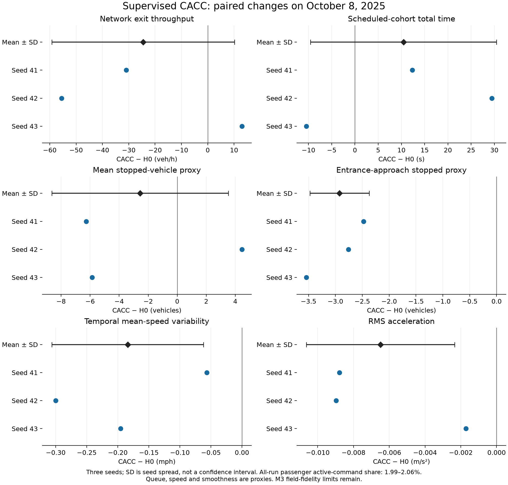

# M5 cooperative CACC closeout

**Status: complete for the supervised comparison. Closed 2026-10-16.**

M5 evaluates a conservative supervised CACC policy under frozen H0 assumptions.
Three more continuous approaches failed the run-health gates and are retained.
The supervised treatment is deliberately limited; it cannot establish the
benefit of continuous or full-fleet cooperative driving.

## Specification and reproduction

The [plan](m5-cooperative-cacc-plan.md), committed at c276d1f, preceded the
[original specification](m5-cooperative-cacc-spec.md), committed at 9fe5c69,
and source implementation. The rejected native-model contract is
[revision 3](m5-native-cacc-spec.md). The active
[supervised specification](m5-supervised-cacc-spec.md), committed at 75d4ad4,
preceded the final source at 643d0da. No following-gain or demand tuning was made
after outcomes; revisions addressed the native maneuver integration seam.

Install dependencies only in the project `.venv`, including official
`libsumo==1.27.1`. With frozen M3 input profiles/network available:

```bash
PYTHONPATH=src .venv/bin/python -m bay_area_traffic_sim run-us101-experiment --config configs/us101_m5_experiment.json
```

The [configuration](../configs/us101_m5_experiment.json) declares H0/CACC,
October 8, 2025, seeds 41–43, 1 s trajectory samples, a 0.1 m/s stopped threshold,
and three isolated worker processes. Outputs are under
`outputs/us101_corridor/m5/m5_h0_supervised_cacc_2025_10_08/`. Repeat using a
new experiment ID; existing outputs are preserved.

Recheck raw trip/summary data and regenerate the figure with:

```bash
.venv/bin/python scripts/audit_m5_results.py --report reports/m5/report.json --output outputs/us101_corridor/m5/independent_audit_replay.json
.venv/bin/python scripts/plot_m5_results.py
```

## Policy and populations

Every passenger is equipped (96% expected fleet share); trucks remain human
driven. A passenger following a passenger can use previous-step acceleration
with ideal messages and no added network delay within a 250 m TraCI gap.
Behind trucks, use gap/relative-speed feedback without feedforward. The original
law retains 1.5 s headway, 2.5 m minGap, gains 0.4/0.2/0.8/0.5 and acceleration
limits 2.6/4.5 m/s². Native Krauss safety, speedMode 31 and lane-change mode 1621
remain. No all-pairs vehicle scans are used.

The supervisor yields speed authority to native SUMO for any applicable native
lane-change/cooperation state beyond NONE/STAY, or a required best-lane change
or unmatched internal lane. It waits 2 s after insertion/requests before
re-engaging. This includes hypothetical blocked lane changes and is therefore
very conservative. Counts distinguish active following/cruise requests, native
maneuver samples, quiet-period samples and missing-state fallbacks. The raw
`controlled_vehicles` diagnostic counts equipped passengers on entry; it does
not mean each passenger was continuously controlled.

All three 3,000 s probes passed without warnings or missing-state fallbacks.
Only about 1.3–1.5% of their passenger timesteps had active CACC commands.
Final whole-run active shares are 1.9939–2.0603%, reported below alongside performance.
The policy is deterministic given state; native traffic and fleet sampling
remain seed dependent. This is a combined supervised longitudinal policy, not
an isolated V2V ablation or SUMO's native CACC model.

Trajectory metrics retain the M4 `[900, 8100)` window and domains. Actual-window
departure cohorts exclude insertion delay. Scheduled-window departure totals
include duration plus departDelay and use their own population. Whole-run and
window insertion backlog maxima stay distinct from on-road stopped proxies.
Pairs are CACC minus H0 for matching seed/date; spread is sample SD across seeds.

## Rejected approaches and retained evidence

| Approach | Observed rejection |
| --- | --- |
| Persistent external overlay | Wrong-lane exit teleport at 2123 s for estimated_downstream_net_exit_warmup.255. The run was then interrupted; later startup errors are not valid CACC seed results. |
| Best-lane-only native release | Complete matrix: 2, 1, 2 teleports for CACC seeds 41, 42, 43. All three runs fail acceptance despite completing trips. |
| Native SUMO CACC | Seed-43 preflight through 3000 s: 40 emergency-braking warnings, including 9 m/s² braking. Not accepted or used for performance claims. |

See the [initial report](../reports/m5/rejected_socket_report.json),
[revision-2 full matrix](../reports/m5/rejected_revision2_report.json),
[rejection audit](../reports/m5/rejected_revision2_audit.json), and
[native preflight](../reports/m5/rejected_native_preflight.json).
The rejection audit confirms exact routes, realized fleet and schedules and
null performance aggregates for invalid groups/pairs. Failed outputs were not
pooled into the final matrix.

SUMO source inspection shows native lane-change speed adjustments can precede
TraCI speed overrides. The earlier release rule considered only the ego best
lane, missing surrounding vehicles' maneuver/cooperation needs. Revision 4
supervises all applicable native state flags. A 3000 s regression for the first
correction completed the originally teleported exit at 1301.5 s, but the later
full matrix still rejected that intermediate approach. Passing a small probe
was not treated as full-corridor validation.

## Acceptance evidence

| Criterion | Evidence |
| --- | --- |
| AC1 | Plan, original spec and active revision-4 spec precede their implementations; rejected contracts remain historical records. |
| AC2 | Hand-calculated law/metric/pairing cases, minGap convention, clipping, invalid policy/worker settings and native handoff timing. |
| AC3 | Real SUMO deterministic replay and exact small-case numeric equality across socket/libsumo; native strategic exit; all three clean supervised probes. |
| AC4 | Tests cover matched physical settings, isolated jobs, failure/diagnostic retention, null aggregates, policy provenance and cleanup. |
| AC5 | 6/6 accepted runs. Each loaded, inserted and ended 22,951 vehicles; no warnings, collisions, teleports or final backlog. H0 replays every M4 metric and detector summary exactly. |
| AC6 | Independent audit passed six raw trip/summary records, all 30 paired metrics, every seed aggregate, unchanged source/route/network/input hashes, and matching exported vehicle IDs/types/speed factors/reconstructed schedules. |
| AC7 | 102 tests passed in 8.54 s; lint and whitespace pass. Installed package matches tested source. Repository/Obsidian/GitHub records are synchronized to this closeout; the PR is the publication checkpoint. |

## Results

Means ± sample SD across three seeds; differences are paired CACC minus H0.

| Metric | Unit | H0 | Supervised CACC | Paired difference ± SD | Change |
| --- | --- | ---: | ---: | ---: | ---: |
| Network exit throughput | veh/h | 8274.5000 ± 29.4449 | 8250.0000 ± 12.6194 | -24.5000 ± 34.7095 | -0.30% |
| Actual-departure mean travel time | s | 917.5052 ± 8.8885 | 929.9481 ± 2.5037 | +12.4428 ± 10.2283 | +1.36% |
| Actual-departure p95 travel time | s | 2472.7750 ± 39.0675 | 2514.7917 ± 26.8196 | +42.0167 ± 44.2679 | +1.70% |
| Scheduled-cohort total time | s | 1533.9020 ± 6.4881 | 1544.3669 ± 13.5833 | +10.4649 ± 20.0109 | +0.68% |
| Mean stopped vehicles | vehicles | 88.9196 ± 1.2976 | 86.3635 ± 4.9671 | -2.5561 ± 6.0783 | -2.87% |
| Mean entrance-approach stopped vehicles | vehicles | 10.1361 ± 0.1717 | 7.2126 ± 0.6561 | -2.9235 ± 0.5514 | -28.84% |
| Temporal variability of domain mean speed | mph | 6.0551 ± 0.2184 | 5.8711 ± 0.2454 | -0.1840 ± 0.1222 | -3.04% |
| Mean squared acceleration | m²/s⁴ | 0.6636 ± 0.0015 | 0.6531 ± 0.0056 | -0.0105 ± 0.0067 | -1.59% |
| RMS acceleration | m/s² | 0.8146 ± 0.0009 | 0.8081 ± 0.0035 | -0.0065 ± 0.0041 | -0.80% |
| Whole-run mean insertion delay | s | 589.1094 ± 6.1647 | 587.2371 ± 10.8081 | -1.8724 ± 12.2917 | -0.32% |
| Peak insertion backlog | vehicles | 2800.6667 ± 45.7420 | 2815.6667 ± 65.0641 | +15.0000 ± 88.4251 | +0.54% |

| Seed | Equipped passengers | Active CACC requests | Native samples | Active share |
| --- | ---: | ---: | ---: | ---: |
| 41 | 22,018 | 759,189 | 36,088,596 | 2.0603% |
| 42 | 22,030 | 765,666 | 36,405,102 | 2.0599% |
| 43 | 22,060 | 737,775 | 36,263,805 | 1.9939% |

The mixed changes do not demonstrate an overall traffic benefit. Throughput fell
0.30%; scheduled-cohort total time increased 0.68%; RMS acceleration fell 0.80%.
The entrance-approach stopped proxy fell 28.84% (10.14→7.21 vehicles), while
peak insertion backlog rose 0.54%. The entrance proxy excludes vehicles waiting
to insert, so its reduction is not a reduction in all ramp-related delay.
The paired SD exceeds the mean change for throughput and scheduled total time.
No inferential significance test or field validation is claimed from three seeds. Active requests
cover only about 2% of all-run passenger timesteps; the rest use native behavior.
These results qualify this supervised comparison, not continuous CACC.




## Limits and next milestone

- M3 missed the October 15 held-out bottleneck and combined held-out speed
  target (14.90 mph MAE). M5 does not recalibrate or field-validate H0.
- The low-engagement supervisor is the evaluated policy. Continuous CACC
  remains unresolved; no full-fleet capacity or V2V-only benefit follows.
- The original gains are engineering defaults, not calibrated vehicle response.
  One calibration date and three seeds describe stochastic spread only.
- Actual-departure means and scheduled-cohort totals cover different trips;
  do not subtract their means to infer delay for a common cohort.
- Exit throughput includes ramps. Domain speed metrics include ramps, buffer
  and internal links; variability does not establish string stability.
  Acceleration squared/RMS describe smoothness, not energy use.
- Clean SUMO simulations are not real-world safety or deployment certification.
  M7 must address penetration, activation, demand, communication and numerical
  sensitivities. M6 is the next roadmap step. Continuous CACC remains unresolved.
