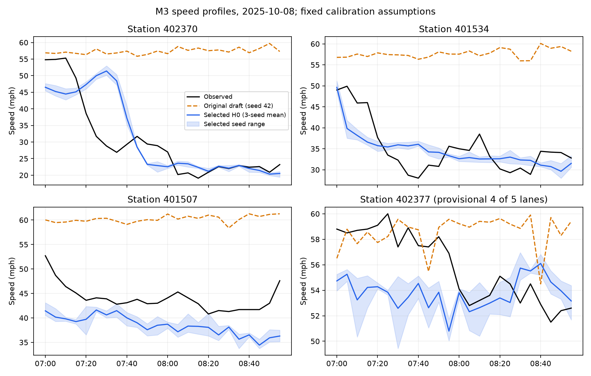
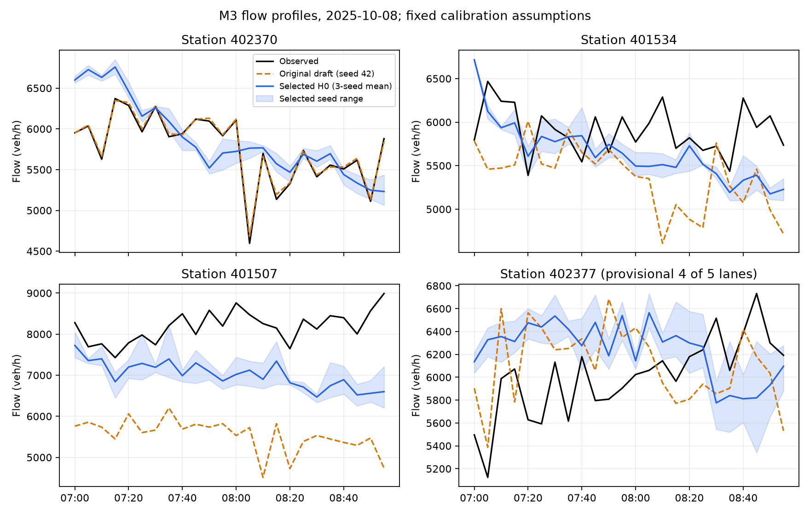
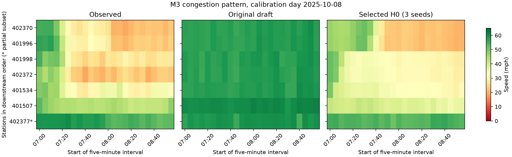
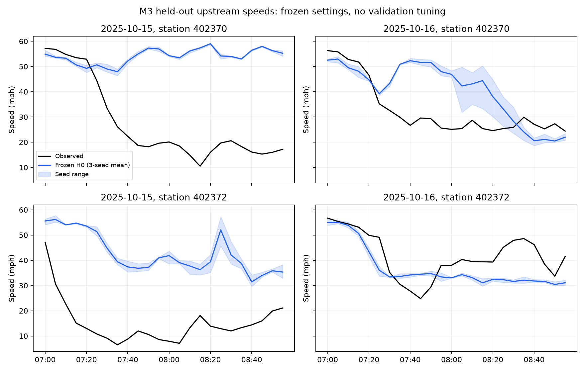

# M3 calibration and separate-day validation results

Generated by `scripts/summarize_m3_baseline.py` from saved JSON reports.
The versioned `profile_series.json` preserves five-minute observed/modeled series so these figures can be regenerated without the ignored SUMO runtime files.

## Outcome

M3's evaluation is complete. H0 remains provisional: the combined held-out speed target was missed, and October 15 missed both fidelity targets. Clean simulation health does not establish traffic fidelity. Settings were frozen before validation and were not retuned afterward. See [the closeout decision](../../docs/m3-human-baseline-report.md).

Targets: mean full-cross-section flow MAPE ≤20%, speed MAE ≤10 mph.

| Phase | Mean flow MAPE (%) | Mean speed MAE (mph) |
| --- | ---: | ---: |
| Calibration (15 runs) | 8.32 | 8.15 |
| Held-out validation (6 runs) | 19.37 | 14.90 |

## Fixed settings

Selected case: **buffer_exit_tau15**. Three seeds (41–43) on each of five calibration weekdays and two reserved validation weekdays. Station summaries weight days equally and average seeds within each day. Station 402377 is a provisional four-lane subset and is excluded from candidate scoring.
Station 400790 supplies the 80%-coverage inlet proxy upstream of the analysis reach; it is not scored. The six full-cross-section targets retain 90% coverage and their flow and speed are model outcomes. Validation conditions on each day's measured upstream and reporting-ramp counts.

## Station errors

| Station | Calibration flow MAPE (%) | Calibration speed MAE (mph) | Validation flow MAPE (%) | Validation speed MAE (mph) |
| --- | ---: | ---: | ---: | ---: |
| 401507 | 13.49 | 8.62 | 20.92 | 6.72 |
| 401534 | 6.91 | 6.83 | 18.95 | 11.49 |
| 401996 | 6.68 | 8.16 | 9.25 | 18.06 |
| 401998 | 8.41 | 8.38 | 21.75 | 16.47 |
| 402370 | 6.46 | 7.75 | 9.69 | 19.39 |
| 402372 | 7.97 | 9.17 | 35.68 | 17.30 |
| 402377 (partial) | 12.84 | 8.62 | 13.60 | 7.79 |

## Validation by day

| Date | Mean full-lane flow MAPE (%) | Mean full-lane speed MAE (mph) | Runs clean and cleared |
| --- | ---: | ---: | ---: |
| 2025-10-15 | 29.95 | 21.50 | 3/3 |
| 2025-10-16 | 8.79 | 8.30 | 3/3 |

## Congestion timing

The congestion-pattern figure compares stations in downstream order on the preselected calibration day. `timing_summary.json` records, for every final run and reporting station, the first paired interval below 45 mph and the lowest-speed interval. This descriptive threshold was not used for fitting. Five-minute sampling and a first interval already below the threshold limit onset precision; missing crossings remain null.

## Calibration candidate ledger

| Candidate | Mean flow MAPE (%) | Mean speed MAE (mph) | SUMO warning lines | Vehicles still running/waiting at recorded end |
| --- | ---: | ---: | ---: | ---: |
| tau12 | 5.62 | 21.74 | 0 | 0 |
| tau15 | 8.42 | 11.91 | 0 | 1032 |
| tau18 | 19.00 | 4.75 | 0 | 3421 |
| tau20 | 25.52 | 5.34 | 0 | 5001 |
| tau13 | 5.98 | 19.64 | 0 | 442 |
| tau14 | 6.75 | 14.47 | 0 | 733 |
| tau15_split | 17.05 | 7.59 | 0 | 1096 |
| tau16_split | 21.35 | 5.92 | 4 | 0 |
| tau17_split | 25.17 | 5.06 | 10 | 0 |
| tau18_split | 29.16 | 5.38 | 20 | 0 |
| buffer_tau15 | 10.90 | 5.79 | 0 | 0 |
| buffer_exit_tau15 | 8.38 | 5.93 | 0 | 0 |

Initial/intermediate candidates used 30-minute clearance; the final split cases and frozen calibration/validation use two hours. Failed trials remain in the ledger.

## Sensitivities

| Case | Mean full-lane flow MAPE (%) | Mean full-lane speed MAE (mph) | Clean and cleared |
| --- | ---: | ---: | --- |
| truck02 | 7.94 | 5.96 | True |
| truck06 | 8.97 | 5.83 | True |
| demand_low | 9.13 | 18.75 | True |
| demand_high | 15.48 | 5.98 | False |
| lane_402377_0_3 | 8.38 | 5.93 | True |

## Station 402377 lane sensitivity

Calibration day 2025-10-08, seed 42. All five physical SUMO lanes are recorded; the two four-lane subsets are compared to the same four reporting PeMS channels. SUMO numbers lanes from the right, starting at zero. This is a fit sensitivity, not proof of field wiring.

| SUMO subset | Flow MAPE (%) | Speed MAE (mph) |
| --- | ---: | ---: |
| 1–4 (omit rightmost; working mapping) | 8.61 | 3.01 |
| 0–3 (omit leftmost; alternative) | 23.05 | 4.07 |

## Run health and provenance

Calibration: 15/15 runs clean and cleared. Treatment hash: `bd41772cb9e78b03f91bf239b039eb84fd96e1d6ebe840b4b883768d8203c7aa`.
Validation: 6/6 runs clean and cleared. Treatment hash: `bd41772cb9e78b03f91bf239b039eb84fd96e1d6ebe840b4b883768d8203c7aa`.

Trip metrics cover all generated trips, including warmup and clearance. Three-seed spread covers stochastic driving only. Unknown OD allocation, missing downstream ramp movements, fleet share, meter behavior, and detector mapping remain additional uncertainty. See [the demand ledger](../../docs/m3-demand-ledger.md).

