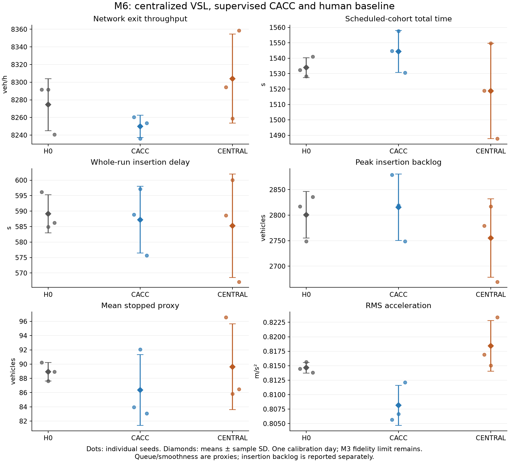

# M6 centralized VSL results

Means ± sample SD across seeds 41–43 on October 8, 2025. Seed spread is not a confidence interval.

| Metric | Unit | H0 | Supervised CACC | CENTRAL |
| --- | --- | ---: | ---: | ---: |
| Network exit throughput | veh/h | 8274.5000 ± 29.4449 | 8250.0000 ± 12.6194 | 8304.0000 ± 50.4257 |
| Actual-departure mean travel time | s | 917.5052 ± 8.8885 | 929.9481 ± 2.5037 | 906.7407 ± 13.3426 |
| Actual-departure p95 travel time | s | 2472.7750 ± 39.0675 | 2514.7917 ± 26.8196 | 2395.6333 ± 59.0448 |
| Scheduled-cohort total time | s | 1533.9020 ± 6.4881 | 1544.3669 ± 13.5833 | 1518.8235 ± 30.9548 |
| Whole-run insertion delay | s | 589.1094 ± 6.1647 | 587.2371 ± 10.8081 | 585.2663 ± 16.7409 |
| Peak insertion backlog | vehicles | 2800.6667 ± 45.7420 | 2815.6667 ± 65.0641 | 2755.0000 ± 76.8635 |
| Mean stopped proxy | vehicles | 88.9196 ± 1.2976 | 86.3635 ± 4.9671 | 89.6181 ± 6.0222 |
| Entrance-approach stopped proxy | vehicles | 10.1361 ± 0.1717 | 7.2126 ± 0.6561 | 9.9663 ± 0.3954 |
| Temporal mean-speed variability | mph | 6.0551 ± 0.2184 | 5.8711 ± 0.2454 | 5.9324 ± 0.0835 |
| Mean squared acceleration | m²/s⁴ | 0.6636 ± 0.0015 | 0.6531 ± 0.0056 | 0.6698 ± 0.0072 |
| RMS acceleration | m/s² | 0.8146 ± 0.0009 | 0.8081 ± 0.0035 | 0.8184 ± 0.0044 |

## Paired differences

Treatment minus reference, with sample SD of seed differences.

| Metric | CACC − H0 | CENTRAL − H0 | CENTRAL − CACC |
| --- | ---: | ---: | ---: |
| Network exit throughput | -24.5000 ± 34.7095 (-0.30%) | +29.5000 ± 78.6718 (+0.36%) | +54.0000 ± 44.5084 (+0.65%) |
| Actual-departure mean travel time | +12.4428 ± 10.2283 (+1.36%) | -10.7646 ± 19.3678 (-1.17%) | -23.2074 ± 10.8468 (-2.50%) |
| Actual-departure p95 travel time | +42.0167 ± 44.2679 (+1.70%) | -77.1417 ± 83.2133 (-3.12%) | -119.1583 ± 85.0885 (-4.74%) |
| Scheduled-cohort total time | +10.4649 ± 20.0109 (+0.68%) | -15.0785 ± 37.3444 (-0.98%) | -25.5434 ± 17.3795 (-1.65%) |
| Whole-run insertion delay | -1.8724 ± 12.2917 (-0.32%) | -3.8432 ± 17.4140 (-0.65%) | -1.9708 ± 5.9633 (-0.34%) |
| Peak insertion backlog | +15.0000 ± 88.4251 (+0.54%) | -45.6667 ± 117.6874 (-1.63%) | -60.6667 ± 51.7816 (-2.15%) |
| Mean stopped proxy | -2.5561 ± 6.0783 (-2.87%) | +0.6985 ± 4.9057 (+0.79%) | +3.2546 ± 9.4309 (+3.77%) |
| Entrance-approach stopped proxy | -2.9235 ± 0.5514 (-28.84%) | -0.1698 ± 0.4196 (-1.67%) | +2.7537 ± 0.9667 (+38.18%) |
| Temporal mean-speed variability | -0.1840 ± 0.1222 (-3.04%) | -0.1227 ± 0.2819 (-2.03%) | +0.0614 ± 0.3261 (+1.05%) |
| Mean squared acceleration | -0.0105 ± 0.0067 (-1.59%) | +0.0062 ± 0.0085 (+0.94%) | +0.0167 ± 0.0027 (+2.56%) |
| RMS acceleration | -0.0065 ± 0.0041 (-0.80%) | +0.0038 ± 0.0052 (+0.47%) | +0.0103 ± 0.0017 (+1.27%) |

## Central actuation

| Seed | Congested decisions | Changed-lane commands | Limited-lane seconds |
| --- | ---: | ---: | ---: |
| 41 | 153 | 140 | 65940 |
| 42 | 161 | 140 | 69300 |
| 43 | 160 | 140 | 68880 |

Limited-lane seconds measure reduced-limit exposure, not vehicle compliance. The nonactivating 3000 s preflight is preserved separately. M3 held-out fidelity and M5 approximately 2% CACC engagement remain limitations.

[Closeout and reproduction](../../docs/m6-centralized-control-report.md) · [Frozen specification](../../docs/m6-centralized-control-spec.md) · [Report](report.json) · [Independent audit](independent_audit.json) · [Preflight](preflight_seed41.json)

